<h1 align="center">
  ⚡ Gaurav Kumar
   
  <em>Building Insights Through Data & Technology</em>
</h1>

### Computer Science Student | Data Analytics | Machine Learning

**Turning Data Into Insights. Building Solutions Through Code.**

I explore data, solve problems, and build practical projects at the intersection of  
**Data Analytics, Machine Learning, and Computer Science.**

 

---

## About Me

I'm a Computer Science student interested in understanding how data can solve real-world business problems.

My primary interests include:

- **Data Analytics:** Extracting insights from complex datasets through SQL, Python and statistics.
- **Machine Learning:** Understanding algorithms and applying them to practical problems.
- **Problem Solving:** Strengthening computational thinking through data structures and algorithms.
- **Data Science:** Exploring the intersection of statistical analysis, programming and intelligent systems.

I believe in learning by building, questioning assumptions, and developing solutions that are both technically sound and practically useful.

---

## Technical Skills

<table>
<tr>
<td width="180"><b>Programming Languages</b></td>
<td>

</td>
</tr>
<tr>
<td><b>Data Analytics</b></td>
<td>

</td>
</tr>
<tr>
<td><b>Databases</b></td>
<td>

</td>
</tr>
<tr>
<td><b>Tools & Platforms</b></td>
<td>

</td>
</tr>
<tr>
<td><b>Core Concepts</b></td>
<td>
Data Structures & Algorithms · Statistics · Exploratory Data Analysis · Data Visualization · Database Management
</td>
</tr>
</table>

---

## My Data Analytics Workflow

I approach analytical problems through a structured, end-to-end process.

```mermaid
flowchart LR
    A["01 · Business Problem"] --> B["02 · Data Collection"]
    B --> C["03 · Data Cleaning"]
    C --> D["04 · Exploratory Analysis"]
    D --> E["05 · Statistical Analysis"]
    E --> F["06 · Insights & Visualization"]
    F --> G["07 · Recommendations"]

    style A fill:#245682,color:#fff,stroke:#245682
    style B fill:#245682,color:#fff,stroke:#245682
    style C fill:#245682,color:#fff,stroke:#245682
    style D fill:#245682,color:#fff,stroke:#245682
    style E fill:#245682,color:#fff,stroke:#245682
    style F fill:#245682,color:#fff,stroke:#245682
    style G fill:#16794B,color:#fff,stroke:#16794B
```

**My approach:** Understand the business question first, validate the data, investigate patterns, and communicate findings through actionable insights.

---

## Featured Areas of Work

<table>
<tr>
<td width="50%" valign="top">

### Business & Marketplace Analytics

- Marketplace performance analysis
- Revenue and profitability analysis
- Customer behavior and segmentation
- Incentive effectiveness
- Business performance optimization

</td>
<td width="50%" valign="top">

### Product & Data Intelligence

- Search quality analysis
- Product performance analytics
- Customer retention analysis
- Statistical investigation
- Data-driven decision support

</td>
</tr>
</table>

Explore my implementations and learning projects:

**[Browse All Repositories →](https://github.com/thegkcode?tab=repositories)**

---

## Current Focus

| Area | What I'm Working Towards |
|:---|:---|
| Data Analytics | Advanced SQL, Python, statistics and business analysis |
| Machine Learning | Core algorithms, model evaluation and practical applications |
| Data Visualization | Interactive dashboards and effective data storytelling |
| Problem Solving | Data Structures & Algorithms and computational thinking |
| Professional Development | Building end-to-end, industry-relevant projects |

---

## Problem Solving

I regularly practice Data Structures and Algorithms to improve my logical reasoning, programming skills and ability to approach complex problems.

---

## Writing & Knowledge Sharing

I believe that explaining what you learn is an important part of mastering it.

I use Medium to document technical concepts, programming knowledge and my learning journey.

---

## Principles I Follow

- **Understand Before Building:** Start with the problem, not the technology.
- **Data Over Assumptions:** Validate findings before drawing conclusions.
- **Quality Over Quantity:** Build meaningful projects instead of collecting generic ones.
- **Consistency Over Intensity:** Improve through deliberate and continuous practice.

---

## Let's Connect

**Open to collaborations and meaningful technical discussions.**

<a href="mailto:gauravkumargk3004@gmail.com">Email</a> ·
<a href="https://github.com/thegkcode">GitHub</a> ·
<a href="https://leetcode.com/always_gk">LeetCode</a> ·
<a href="https://medium.com/@gauravkumargk3004">Medium</a> ·
<a href="https://twitter.com/gk_kumar3126">X</a>

 

*Always learning. Always building. Always improving.*

