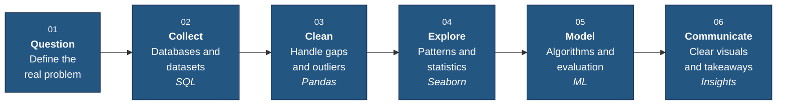

 

<b>COMPUTER SCIENCE &nbsp;·&nbsp; DATA &nbsp;·&nbsp; MACHINE LEARNING</b>

<h1>Gaurav Kumar</h1>

<h3>Aspiring Data Scientist</h3>

Computer Science student building a strong foundation in 
<b>data analytics</b>, <b>machine learning</b> and <b>problem solving</b>.

<a href="mailto:gauravkumargk3004@gmail.com"><b>Email</b></a> &nbsp;·&nbsp;
<a href="https://leetcode.com/always_gk"><b>LeetCode</b></a> &nbsp;·&nbsp;
<a href="https://medium.com/@gauravkumargk3004"><b>Medium</b></a> &nbsp;·&nbsp;
<a href="https://twitter.com/gk_kumar3126"><b>X</b></a> &nbsp;·&nbsp;
<a href="https://github.com/thegkcode?tab=repositories"><b>Repositories</b></a>

 

> [!TIP]
> Open to internships, collaboration and technical conversations in Data Analytics and Machine Learning.

 

## At a glance

| | |
|:--|:--|
| **Focus** | Data Analytics · Machine Learning · Data Science |
| **Core stack** | Python · SQL · Pandas · Seaborn |
| **Foundations** | C · C++ · Java · JavaScript · Data Structures & Algorithms |
| **Databases** | MySQL · MongoDB · Oracle |
| **Environment** | Git · GitHub · Linux · AWS · Arduino |

 

## About

I treat technology as a way to understand a problem before solving it. My work centers on exploring data, finding patterns, and turning raw information into insights people can act on.

I learn by building, stay curious about how things work underneath, and improve through consistent, deliberate practice.

 

## How I work with data

From a raw question to a decision someone can use.

 

## Technical profile

<table>
<tr>
<td width="190" valign="top"><b>Programming</b></td>
<td>
<picture>
  <source media="(prefers-color-scheme: dark)" srcset="https://skillicons.dev/icons?i=python,c,cpp,java,js&theme=dark">
  
</picture>
 Python for analysis and ML. C, C++ and Java for fundamentals and problem solving.
</td>
</tr>
<tr>
<td valign="top"><b>Data analytics</b></td>
<td>
<code>Pandas</code> &nbsp; <code>Seaborn</code> &nbsp; <code>Exploratory analysis</code> &nbsp; <code>Data visualization</code>
 Exploring datasets, identifying patterns, communicating insights.
</td>
</tr>
<tr>
<td valign="top"><b>Databases</b></td>
<td>
<picture>
  <source media="(prefers-color-scheme: dark)" srcset="https://skillicons.dev/icons?i=mysql,mongodb&theme=dark">
  
</picture>

 Relational and document databases, with SQL as the main query language.
</td>
</tr>
<tr>
<td valign="top"><b>Tools & platforms</b></td>
<td>
<picture>
  <source media="(prefers-color-scheme: dark)" srcset="https://skillicons.dev/icons?i=git,github,linux,aws,arduino&theme=dark">
  
</picture>
 Version control, Linux workflow, cloud basics and embedded prototyping.
</td>
</tr>
</table>

 

## Current focus

| Exploring | Working towards |
|:--|:--|
| **Data Analytics** End-to-end analysis: cleaning, exploration, visualization, insight reports. | **Stronger technical foundations** Cleaner code, solid fundamentals, deeper understanding. |
| **Machine Learning** Core algorithms first, then applying them to real datasets. | **Practical project experience** Building projects that each teach something specific. |
| **Python & SQL** Readable analysis code and efficient queries. | **Better problem solving** Regular data structures and algorithms practice. |
| **Data Science** Turning analysis into decisions people can use. | **Continuous growth** Consistency over intensity. |

 

## Principles

**Build with intention.** Every project should teach something specific. 
**Think with clarity.** A simple, correct solution beats a clever, fragile one. 
**Keep evolving.** Progress over perfection, every week.

 

## Elsewhere

<table>
<tr>
<td width="33%" valign="top">
<b>Problem solving</b> 
Regular practice on data structures and algorithms to sharpen how I break down problems and reason about efficiency.  
<a href="https://leetcode.com/always_gk"><b>LeetCode profile →</b></a>
</td>
<td width="33%" valign="top">
<b>Writing</b> 
I document what I learn in data and programming, because explaining an idea is the fastest way to understand it.  
<a href="https://medium.com/@gauravkumargk3004"><b>Articles on Medium →</b></a>
</td>
<td width="33%" valign="top">
<b>Work</b> 
Public repositories with my experiments, practice and learning progress.  
<a href="https://github.com/thegkcode?tab=repositories"><b>Browse repositories →</b></a>
</td>
</tr>
</table>

 

---

 

**Let's connect**

Open to conversations about Data Analytics, Machine Learning and collaboration.

<a href="mailto:gauravkumargk3004@gmail.com"><b>gauravkumargk3004@gmail.com</b></a>

<a href="https://leetcode.com/always_gk">LeetCode</a> &nbsp;·&nbsp;
<a href="https://medium.com/@gauravkumargk3004">Medium</a> &nbsp;·&nbsp;
<a href="https://twitter.com/gk_kumar3126">X</a> &nbsp;·&nbsp;
<a href="https://github.com/thegkcode">GitHub</a>

 

